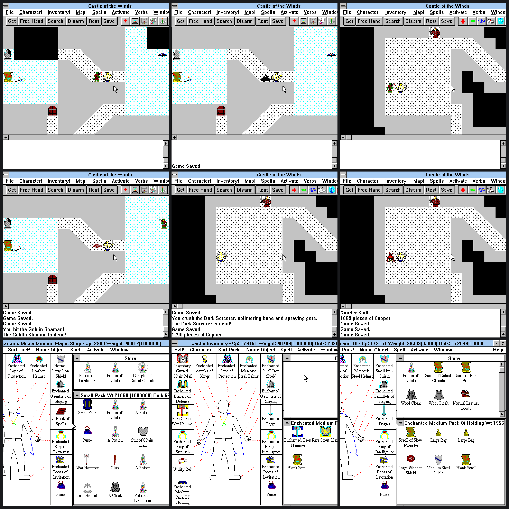
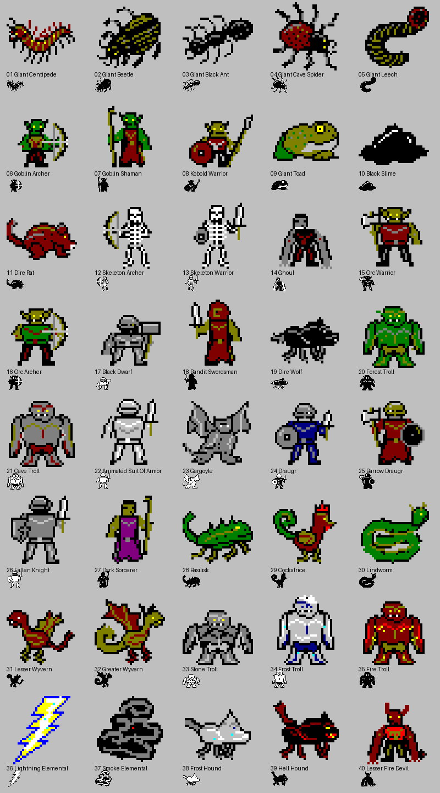
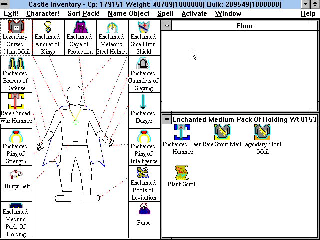
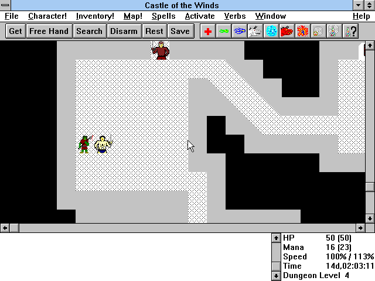

# Castle of the Winds I & II: Redone

Modular patches for both chapters of the original 16-bit *Castle of the Winds* v1.1A, by **RetchERezzed**.

| Download | What it changes |
| --- | --- |
| [All-in-One v1.0](https://github.com/RetchERez/CastleOfTheWindsRedone/releases/tag/all-in-one-v1.0-full) | Installs DiabloLoot, Black Background, and More Monsters together |
| [DiabloLoot v1.2](https://github.com/RetchERez/CastleOfTheWindsRedone/releases/tag/diabloloot-v1.2) | Adds randomized gear to enemy drops and shop stock, with broader, color-coded rarity marks. |
| [Black Background v1.0](https://github.com/RetchERez/CastleOfTheWindsRedone/releases/tag/black-background-v1.0) | Makes unexplored map cells black while keeping explored tiles and the interface in their original colors. |
| [More Monsters v1.0](https://github.com/RetchERez/CastleOfTheWindsRedone/releases/tag/more-monsters-v1.0) | Adds 25 enemy types in Part I and 40 in Part II, all with original 32×32 sprites |

## Install

1. Get the original Win16 v1.1A `castl11a.zip` with both games and their help files. [Original game archive at Boxedwine](https://www.boxedwine.org/app/castleofthewindows/)
2. On 64-bit Windows, open the `windows-setup.exe` asset for the release you want. The setup includes its own runtime and accepts the original ZIP or the folder you extracted it to.
3. Choose a new destination and select **Install**. Setup writes a separate folder for each chapter.
4. Run `CASTLE1.EXE` for *A Question of Vengeance* or `CASTLE2.EXE` for *Lifthransir's Bane* in a Win16 runtime. Verification used Windows 3.1 under DOSBox.

For Linux or scripted installs, extract the portable patch ZIP and run `python3 apply_redone.py castl11a.zip Castle-Redone`. Substitute your original files folder or a compatible Redone folder as the first argument if needed.

DiabloLoot and Black Background can be stacked in either order. To install all three mods, use All-in-One with the original game or a compatible current or preview installation as the source. Copy your saves separately into the matching chapter's new folder.

## In-game previews

| DiabloLoot | Black Background |
| --- | --- |
|  |  |

## Verification

- [DiabloLoot test results](docs/verification/DiabloLoot.txt) cover kills, drops, pickup, reload, curses, and shop stocking and restocking in each chapter. [DiabloLoot v1.2 results](docs/verification/DiabloLoot%20v1.2.txt) cover the more visible rarity marks.
- [Black Background test results](docs/verification/Black%20Background.txt) compare the original and patched screens in both chapters.
- [More Monsters test results](docs/verification/More-Monsters.txt) cover the native spawn paths, combat and save/load in both chapters.

See the [build instructions](docs/Building.md) to produce the patches from your own original files.
