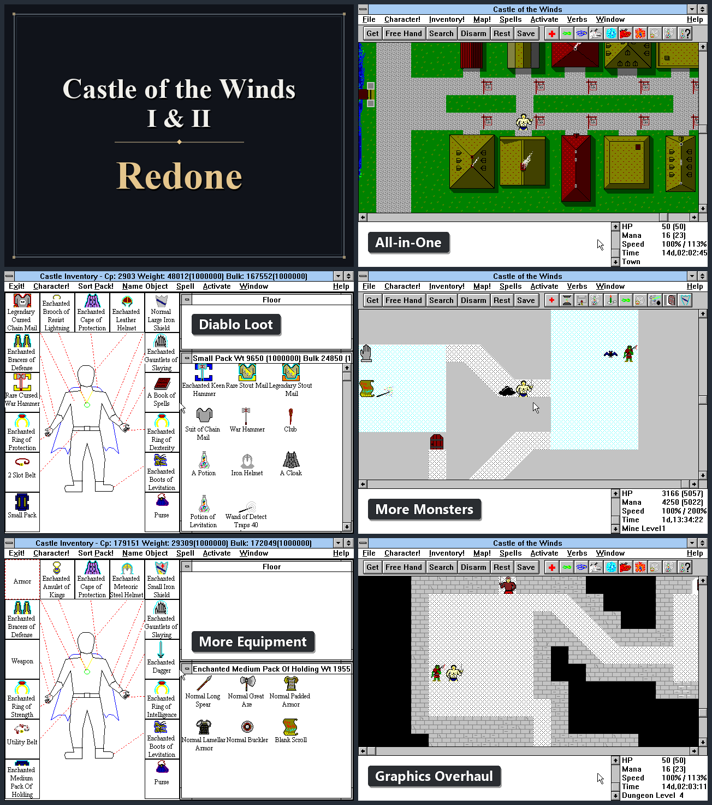

# Castle of the Winds I & II: Redone

Five mods for both adventures of the original Win16 *Castle of the Winds* v1.1A, by **RetchERezzed**.

[Download Redone v1.0](https://github.com/RetchERez/CastleOfTheWindsRedone/releases/tag/redone-v1.0-refresh)

| v1.0 package | What it changes |
| --- | --- |
| **All-in-One** | Installs the four gameplay and graphics mods together and includes the Enhanced Interface theme selector |
| **Diablo Loot** | Adds randomized gear to enemy drops and shops, with blue Enchanted, yellow Rare, and orange Legendary marks. Cursed gear reveals its rarity when equipped |
| **More Monsters** | Adds 25 enemy types in Part I and 40 in Part II, with original 32 × 32 sprites and the existing spawn points |
| **More Equipment** | Adds 16 weapons and 12 other equipment types to each game, including the Buckler and Potion Belt |
| **Graphics Overhaul** | Gives unexplored dungeon areas a black background and updates walls, outdoor textures, town details, monster art, item icons, and toolbar icons. Town graphics include wooden signs and reddish-brown roofs. Keeps the original dungeon floors, road layouts, and cobblestone |
| **Enhanced Interface** | Adds Warm Stone and Dark Slate themes for both adventures. Classic restores the appearance of the selected build |

## Install

1. Get the registered Win16 v1.1A archive with both games and their Help files. [Original game archive at Boxedwine](https://www.boxedwine.org/app/castleofthewindows/)
2. On 64-bit Windows, open the Windows Setup for your chosen package. It accepts the original ZIP or an extracted game folder and runs without Python
3. Select a new destination and choose **Install**
4. Run `CASTLE1.EXE` for *A Question of Vengeance* or `CASTLE2.EXE` for *Lifthransir's Bane* in a Win16 runtime

For a scripted install, extract a portable ZIP and run `python3 apply_redone.py castl11a.zip Castle-Redone`. For Graphics Overhaul or More Equipment on the original release, the BPS archives provide per-game apply and restore patches and executable checksums.

### Install all five without All-in-One

1. Install **Diablo Loot** from the original ZIP or extracted game folder
2. Install **More Monsters** from the Diablo Loot output folder
3. Install **More Equipment** from the More Monsters output folder
4. Install **Graphics Overhaul** from the More Equipment output folder
5. Install **Enhanced Interface** from the Graphics Overhaul output folder and select your theme

Choose a new destination at each step. When selecting a previous install, choose the parent folder that contains both adventure folders. The tested sequence produces the same game and Help files as All-in-One. Copy saves into the corresponding adventure folders after installing.

The standalone Enhanced Interface setup defaults to Warm Stone. All-in-One defaults to Classic. To switch themes, close both games and rerun Setup with **Change the theme in an existing installation** selected.

## In-game preview

[View the individual 640 × 480 screenshots](docs/verification/screenshots), including the original title screen and a screenshot for each mod.

## Verification

See the [updated v1.0 test coverage and checksums](docs/verification/Redone-v1.0-refresh.md), the [original v1.0 test record](docs/verification/Redone-v1.0.md), and the [development notes for the earlier modular packages](docs/Building.md).
